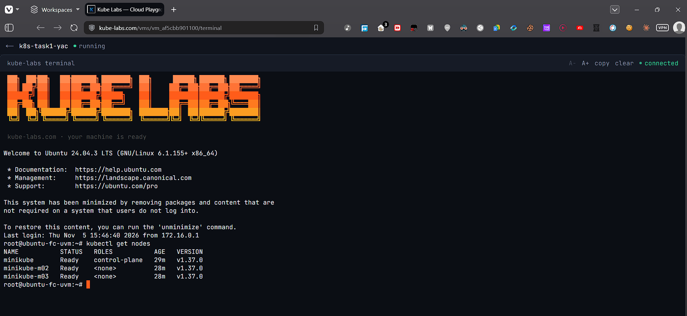
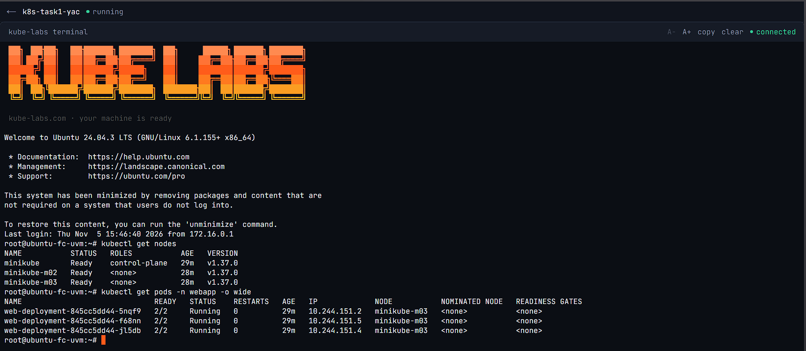
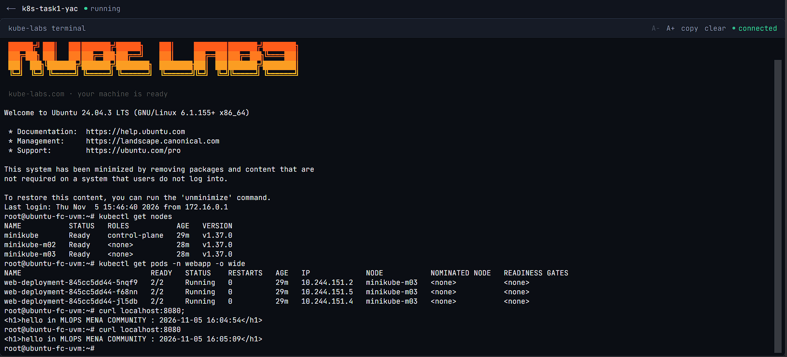
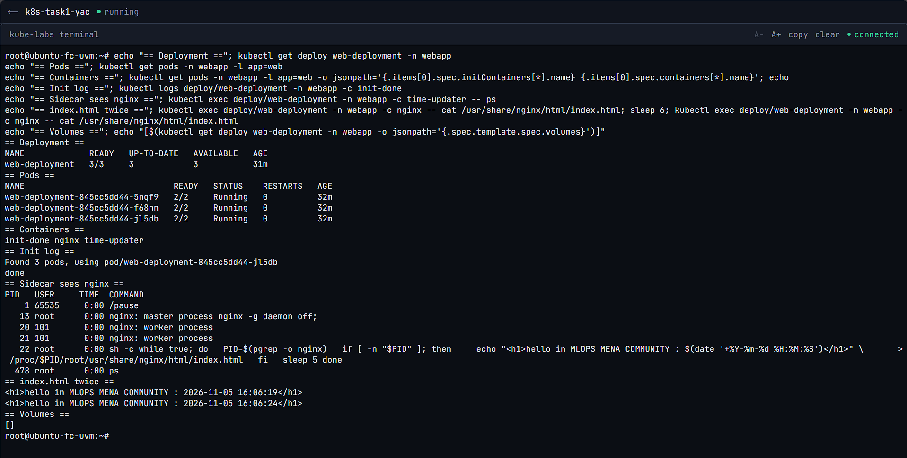
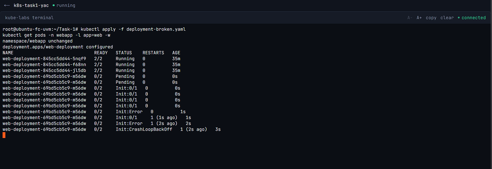
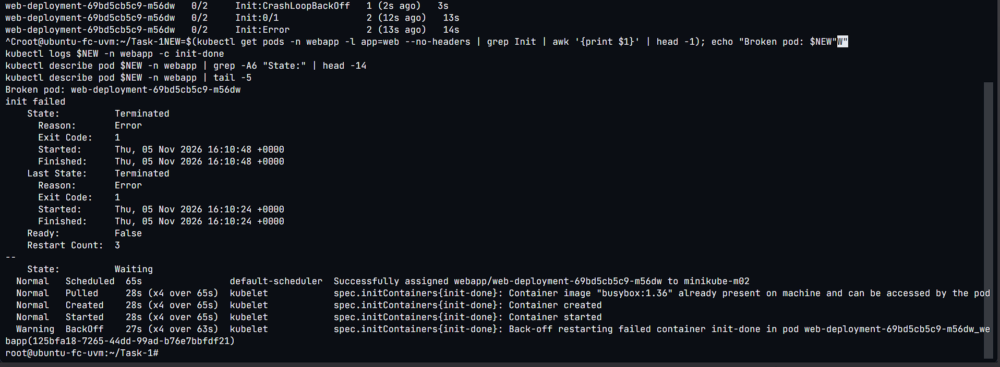
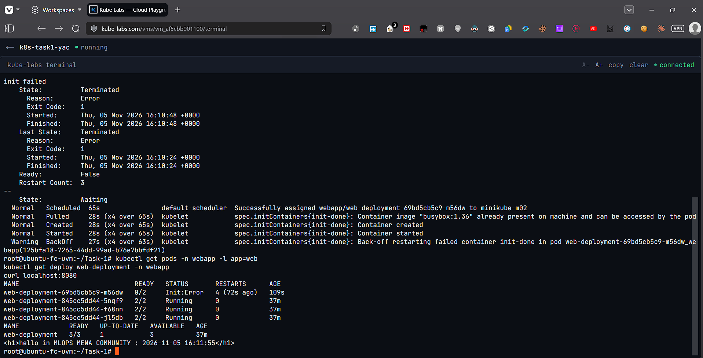
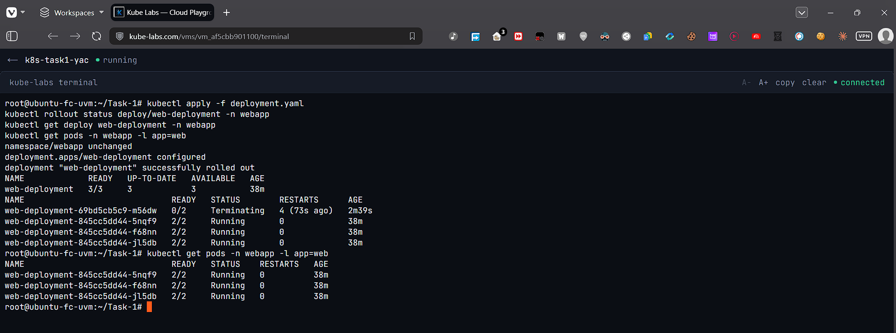

# 🧪 Task 1 — Multi-container Pods (Init Container & Sidecar)

An nginx "hello" page on a **3-node minikube cluster** that shows the current time, refreshed every 5 seconds by a sidecar — with **no volumes**:

```text
hello in MLOPS MENA COMMUNITY : 2026-11-05 15:54:53
```

## 📁 Files

| File | Purpose |
|------|---------|
| `deployment.yaml` | Namespace `webapp` + Deployment `web-deployment` (working version) |
| `deployment-broken.yaml` | Same Deployment, but `init-done` exits with code `1` (Step 5) |
| `screenshots/` | Proof of every step |

## 🧩 Pod design

| Container | Type | Image | Job |
|-----------|------|-------|-----|
| `init-done` | Init container | `busybox:1.36` | Prints `done` and exits `0`. The others start only after it succeeds. |
| `nginx` | Main | `nginx:1.27` | Writes `index.html` with the time, then runs `nginx -g 'daemon off;'` on port 80 |
| `time-updater` | Sidecar | `busybox:1.36` | Every 5 s finds the nginx PID and rewrites the page through `/proc/<pid>/root/...` |

**How it works without a volume**

- `shareProcessNamespace: true` puts all containers of the Pod in one process tree, so the sidecar can see the nginx process (`pgrep -o nginx` → the master process).
- `/proc/<pid>/root` is a view of that process's root filesystem, so the sidecar writes straight into the nginx container's `/usr/share/nginx/html/index.html`.
- The sidecar needs the `SYS_PTRACE` capability to access another container's `/proc/<pid>/root`.

---

## 🖥️ Environment

- **kube-labs.com** Docker VM (Large: 2 vCPU, 4 GB RAM, Ubuntu 24.04), running as `root`
- minikube v1.39.0, Kubernetes v1.37.0, Docker driver, Calico CNI

```bash
minikube start --nodes 3 --cni=calico --cpus 2 --memory 1900 --force
```

> `--force` is needed because the VM runs as root; `--memory 1900` is the minimum minikube accepts and fits 3 nodes in 4 GB (it is a limit, not a reservation).

### ⚠️ Problems I hit on the VM and how I fixed them

**1. minikube could not create nodes** — Docker failed with
`can't initialize iptables table 'raw': Table does not exist`.
The VM's kernel has no iptables `raw` table, which newer Docker uses for published ports. Fix: tell Docker to skip it.

```bash
mkdir -p /etc/systemd/system/docker.service.d
printf '[Service]\nEnvironment="DOCKER_INSECURE_NO_IPTABLES_RAW=1"\n' > /etc/systemd/system/docker.service.d/no-raw.conf
systemctl daemon-reload && systemctl restart docker
```

**2. Nodes stayed `NotReady`, Pods stayed `Pending`** — `calico-node` was in `Init:CrashLoopBackOff`. Its `install-cni` log showed:
`dial tcp 10.96.0.1:443: i/o timeout` — Calico could not reach the API server through the `kubernetes` ClusterIP on this VM.
Fix: point Calico directly at the API server's address:

```bash
APIIP=$(minikube ip)   # 192.168.49.2
kubectl set env daemonset/calico-node -n kube-system --containers='*' KUBERNETES_SERVICE_HOST=$APIIP KUBERNETES_SERVICE_PORT=8443
kubectl set env deployment/calico-kube-controllers -n kube-system KUBERNETES_SERVICE_HOST=$APIIP KUBERNETES_SERVICE_PORT=8443
```

After this all 3 nodes became `Ready` and the Pods were scheduled.

---

## 🚀 Steps

### 1. Cluster — 1 control-plane + 2 workers

```bash
kubectl get nodes
```



### 2–3. Namespace + Deployment

The namespace and the Deployment are both in `deployment.yaml`.

```bash
kubectl apply -f deployment.yaml
kubectl get pods -n webapp -o wide -w
```

All 3 Pods reach `2/2 Running` (READY counts only `nginx` and `time-updater`, because the init container has already finished).



### 4. The page and the time updates

```bash
kubectl port-forward -n webapp deploy/web-deployment 8080:80 > /dev/null 2>&1 &
curl localhost:8080; sleep 6; curl localhost:8080
```

```text
<h1>hello in MLOPS MENA COMMUNITY : 2026-11-05 15:54:53</h1>
<h1>hello in MLOPS MENA COMMUNITY : 2026-11-05 15:54:58</h1>
```



---

## 🔍 Verification

| # | Check | Result |
|---|-------|--------|
| 1 | 3 nodes | `minikube`, `minikube-m02`, `minikube-m03` → `Ready` ✅ |
| 2 | Deployment ready | `web-deployment  3/3  3  3` ✅ |
| 3 | Pods running | 3 Pods, each `2/2 Running` ✅ |
| 4 | Containers | `init-done nginx time-updater` ✅ |
| 5 | Init succeeded | `kubectl logs ... -c init-done` → `done` ✅ |
| 6 | Sidecar sees nginx | `ps` in `time-updater` shows `13 root nginx: master process nginx -g daemon off;` (PID 1 is `/pause`) ✅ |
| 7 | Time updates | `index.html` read twice from the nginx container: `15:55:13` → `15:55:18` ✅ |
| 8 | No volumes | `.spec.template.spec.volumes` → `[]` ✅ |
| 9 | Failing init | New Pod `Init:Error` → `Init:CrashLoopBackOff`, `0/2`; old 3 Pods stay `2/2 Running` ✅ |
| 10 | Init error details | `init-done`: `Reason: Error`, `Exit Code: 1` ✅ |
| 11 | Fixed | `web-deployment  3/3  UP-TO-DATE 3` ✅ |



---

## 💥 5. Making the init container fail

Only the init command changes (`deployment-broken.yaml`):

```yaml
command: ["sh", "-c", "echo 'init failed'; exit 1"]
```

```bash
kubectl apply -f deployment-broken.yaml
kubectl get pods -n webapp -l app=web -w
```

```text
web-deployment-69bd5cb5c9-hp5dg   0/2     Init:0/1                0             1s
web-deployment-69bd5cb5c9-hp5dg   0/2     Init:Error              0             4s
web-deployment-69bd5cb5c9-hp5dg   0/2     Init:CrashLoopBackOff   1 (2s ago)    7s
web-deployment-69bd5cb5c9-hp5dg   0/2     Init:Error              2 (14s ago)   19s
web-deployment-845cc5dd44-5nqf9   2/2     Running                 0             21m
web-deployment-845cc5dd44-f68nn   2/2     Running                 0             21m
web-deployment-845cc5dd44-jl5db   2/2     Running                 0             21m
```



### Diagnosis

```bash
kubectl logs web-deployment-69bd5cb5c9-hp5dg -n webapp -c init-done
# init failed

kubectl describe pod web-deployment-69bd5cb5c9-hp5dg -n webapp
#   init-done:
#     Command: sh -c echo 'init failed'; exit 1
#     State:          Terminated
#       Reason:       Error
#       Exit Code:    1
#     Restart Count:  4
#   Events:
#     Warning  BackOff  kubelet  Back-off restarting failed container init-done ...
```



### Still serving — zero downtime

```text
NAME             READY   UP-TO-DATE   AVAILABLE
web-deployment   3/3     1            3

$ curl localhost:8080
<h1>hello in MLOPS MENA COMMUNITY : 2026-11-05 15:57:13</h1>
```



### ❓ Answers

**Which status does the new Pod show?**
`Init:Error`, then `Init:CrashLoopBackOff`, with READY `0/2`. The kubelet keeps restarting the init container with a growing back-off delay (10 s, 20 s, 40 s … up to 5 min).

**Do `nginx` and `time-updater` start?**
No. Init containers must all exit with code `0` before any main container starts. `init-done` exits with `1`, so the Pod never gets past the init phase.

**Is the page still reachable, and why?**
Yes. The Deployment uses a **RollingUpdate** strategy (default `maxUnavailable: 25%`, `maxSurge: 25%`). It creates a new Pod first and removes an old one only after the new Pod is **Ready**. The new Pod never becomes Ready, so the rollout stalls (UP-TO-DATE `1`) and the 3 old Pods keep running and serving traffic (AVAILABLE `3`).

---

## 🔧 6. Fixing it

```bash
kubectl apply -f deployment.yaml
kubectl rollout status deploy/web-deployment -n webapp
```

```text
deployment "web-deployment" successfully rolled out
NAME             READY   UP-TO-DATE   AVAILABLE
web-deployment   3/3     3            3
web-deployment-69bd5cb5c9-hp5dg   0/2     Terminating   ...
web-deployment-845cc5dd44-...     2/2     Running       (x3)
```

The working spec is identical to the old ReplicaSet (`845cc5dd44`), so Kubernetes simply scales the broken ReplicaSet to 0 and deletes its Pod — the rollout finishes immediately, with no downtime.



---

## 🧠 What I learned

- Init containers run **in order and to completion** before the app containers; a failing one blocks the Pod at `Init:*` forever (`Init:CrashLoopBackOff`).
- A sidecar can share data with the main container **without a volume** by using `shareProcessNamespace` + `/proc/<pid>/root` (needs `SYS_PTRACE`).
- Rolling updates protect running Pods: a broken new version never replaces healthy old Pods.
- `kubectl logs -c <init-container>` and `kubectl describe pod` (State, Exit Code, Events) are the fastest way to diagnose init failures.

## 🧹 Clean up

```bash
kubectl delete namespace webapp
```
